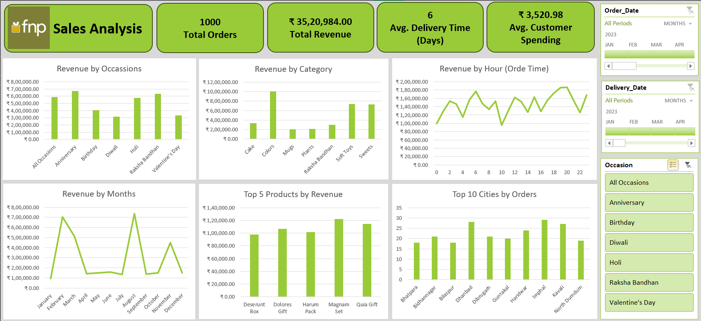

# FNP Sales Analysis Using Microsoft Excel

## Project Overview

This project analyzes sales data from **Ferns N Petals (FNP)**, a gifting business offering products for occasions such as Anniversaries, Birthdays, Diwali, Holi, Raksha Bandhan, and Valentine's Day.

The objective is to transform raw sales data into meaningful business insights about revenue, customer spending, product performance, order trends, and delivery patterns. The analysis was completed using Microsoft Excel, with Power Query for data preparation, Power Pivot for data modeling, DAX for calculated columns, and PivotTables and charts for analysis and visualization.

## Dashboard Preview

## Tools and Features

- Microsoft Excel
- Power Query Editor
- Power Pivot
- Data Model and table relationships
- DAX calculated columns
- PivotTables and PivotCharts
- Slicers and Report Connections

## Project Workflow

1. **Data extraction:** Imported source files from a folder into Power Query.
2. **Data cleaning and transformation:** Cleaned the source data and extracted useful date and time attributes, including hours and days.
3. **Additional columns:** Created derived columns in Power Query to support the analysis.
4. **Data modeling:** Loaded the required tables into the Power Pivot Data Model and established relationships, including one-to-many relationships.
5. **Calculated columns:** Created a Revenue column and a Weekday column using Power Pivot and DAX.
6. **Data analysis:** Built PivotTables to answer the business questions.
7. **Visualization:** Created PivotCharts to communicate the results.
8. **Interactivity:** Added slicers and connected them to relevant PivotTables and charts using Report Connections.

## Business Questions and Key Findings

### 1. What is the total revenue?

- **Total revenue:** ₹35,20,984
- **Total orders:** 1,000

The business generated approximately ₹35.21 lakh across 1,000 orders in the analyzed dataset.

---
### 2. What are the average order and delivery times?

- **Average delivery time:** 6 days
- **Average spending per order:** ₹3,520.98

The average spending figure is total revenue divided by total orders. It is therefore best interpreted as average order value, rather than average spend per unique customer.

---
### 3. How does sales performance vary by month?

The monthly revenue chart shows noticeable fluctuations during the year. February and August are the strongest months in the dashboard, with August appearing to be the peak. March and November also show relatively strong revenue.

This variation can help the business plan inventory, promotional activity, and operational capacity around higher-demand periods.

---
### 4. Which products generate the highest revenue?

The overall Top 5 Products by Revenue chart identifies:

1. Magman Set
2. Quia Gift
3. Dolores Gift
4. Harum Pack
5. Deserunt Box

Magman Set is the highest revenue-generating product among the five shown in the overall dashboard.

---
### 5. What is the average customer spending?

The dashboard reports **₹3,520.98**. Based on the displayed total revenue and order count, this is the average revenue per order.

---
### 6. How do the top five products perform?

The Top 5 Products by Revenue chart compares the revenue generated by the five leading products. Magman Set leads the group, followed by Quia Gift and Dolores Gift.

This comparison can help identify products to monitor for inventory planning and promotional opportunities.

---
### 7. Which cities have the highest number of orders?

The Top 10 Cities by Orders chart highlights the cities with the highest order counts. Imphal, Dhanbad, and Kavali are among the leading cities in the overall dashboard.

These locations may be useful priorities for targeted marketing and customer engagement.

---
### 8. Is order quantity related to delivery time?

The calculated correlation coefficient between order quantity and delivery time is **0.003**.

This value is extremely close to zero and indicates a negligible linear relationship in the analyzed data. The result suggests that higher order quantities do not show a meaningful linear association with longer delivery times in this dataset. Correlation does not establish causation or rule out non-linear relationships.

---
### 9. How does revenue compare across occasions?

The occasion slicer was used to examine each occasion separately. The revenue values displayed in the filtered dashboard views are:

| Occasion | Revenue |
|---|---:|
| Anniversary | ₹6,74,634 |
| Raksha Bandhan | ₹6,31,585 |
| Holi | ₹5,74,682 |
| Birthday | ₹4,08,194 |
| Valentine's Day | ₹3,31,930 |
| Diwali | ₹3,13,783 |

Anniversary is the highest revenue-generating occasion among these six categories, followed by Raksha Bandhan and Holi. Diwali has the lowest revenue among the six.

**Data note:** The slicer also contains an **All Occasions** category. It is a separate category in the source data, not the unfiltered overall total. It accounts for 126 orders and ₹5,86,176 in revenue. Together, this category and the six named occasions reconcile to the overall 1,000 orders and ₹35,20,984 revenue.

---
### 10. Which products are popular for different occasions?

The occasion slicer was used to identify the highest revenue-generating product within each occasion:

| Occasion | Leading product by revenue |
|---|---|
| Anniversary | Dignissimos Pack |
| Birthday | Deserunt Box |
| Diwali | Aut Box |
| Holi | Harum Pack |
| Raksha Bandhan | Dolores Gift |
| Valentine's Day | Eius Gift |

The leading product differs by occasion, indicating that product preferences vary across gifting occasions. This can support occasion-based product recommendations, promotions, and inventory planning.

---
## Occasion-Based Dashboard View

The dashboard's Occasion slicer filters the revenue and product analysis for the selected occasion. Dashboard for filtered views against each occasion can be seen into below document.

## Skills Demonstrated

- Data extraction and preparation
- Data cleaning and transformation using Power Query
- Data modeling and table relationships using Power Pivot
- Calculated columns using DAX
- PivotTable-based business analysis
- PivotCharts and interactive dashboard development
- Slicer configuration and Report Connections
- Translating business questions into data-driven insights

## Conclusion

This project demonstrates an end-to-end Excel-based sales analysis workflow, from extracting and preparing source data to building a relational Data Model and an interactive dashboard. The analysis highlights overall revenue performance, monthly trends, leading products and cities, occasion-based purchasing patterns, and the relationship between order quantity and delivery time.

---

# 👤 Author

**Prayag Dave**

GitHub: [@prayag-dave-01](https://github.com/prayag-dave-01)

---

## ⭐ Portfolio

This repository is part of a portfolio focused on building practical projects using data cleaning, analysis, visualization and business storytelling.
